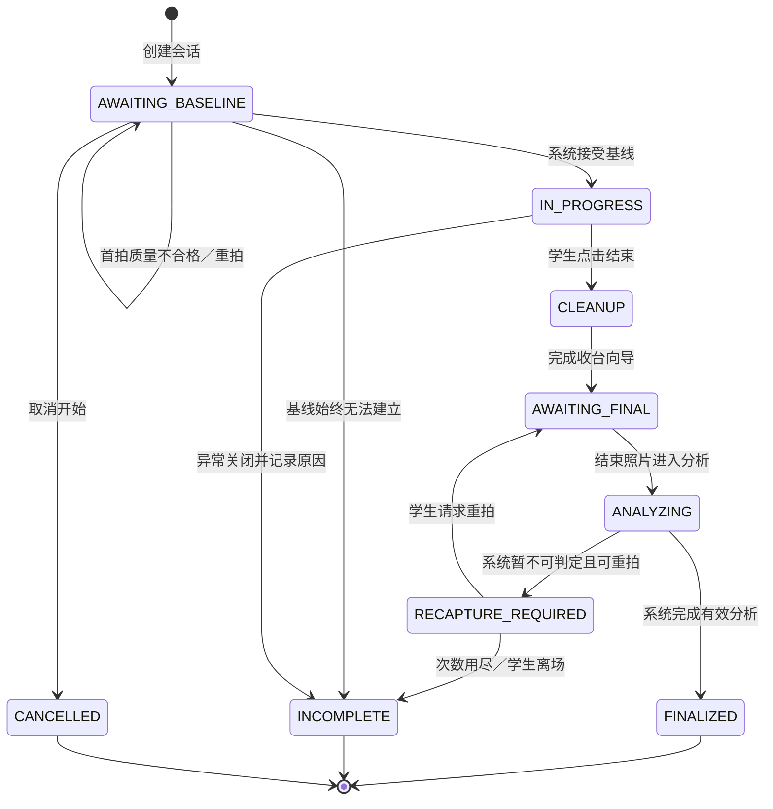

# 智能实验室终端接口与数据契约

| 项目 | 内容 |
| --- | --- |
| 文档版本 | 0.1.0 |
| 日期 | 2026-10-12 |
| 状态 | 设计基线；接口、数据库和服务均待实现与验证 |
| 适用范围 | 终端应用、端侧视觉 worker、后台服务、教师查看端、报告导出服务 |
| 算法依赖基线 | AnchorDiff v0.6.1，提交 `e5d6798`；交付时记录完整提交 SHA 与依赖锁定文件 |

本文使用“必须”表示验收约束，“建议”表示当前推荐实现。示例中的身份、图像、分数和时间全部为虚构数据，不表示真实实验结果或已测性能。

## 1. 业务边界与术语

系统流程为：登录并选择实验 → 首次拍照 → 记录仪器类别与位置 → 查看资料与清单 → 完成实验并点击结束 → 收台向导 → 结束拍照 → 系统分析 → 教师查看记录 → 导出报告并线下反馈。

- **基线**：系统按冻结的选帧策略，从本次首拍候选短序列中选出的首份合格 capture，以及它的检测结果、相机参数和版本快照。先按质量排序或打分选帧、再固定基线的具体策略须版本化；不能按事后扰乱度选择基线。基线描述当时的桌面，不证明桌面符合任何整洁标准。
- **仪器**：配置类别表中需要视觉记录的对象，例如示波器、焊台、电源。类别可根据实验室实际使用扩展，不要求事先限定为 4–6 类。
- **位置参考**：基线中对象的图像位置。无需预设固定归位区；结束时允许小幅位移。
- **定位标记**：用于计算相机与桌面之间的几何关系。标记 ID 不表示仪器身份、学生身份或物理资产编号。
- **`label`**：检测模型的类别名称。两台同类仪器可以有相同 `label`，因此 `label` 不等于 `asset_id`。首版不保证辨认同类仪器是否发生物理替换。
- **`attempt`**：一次确定输入、确定版本的分析执行记录。重新拍照或重新分析创建新的 attempt。
- **正式结果**：由受管视觉 worker 生成、经过归档校验并由系统选定的 attempt。教师没有修改或选择正式结果的权限。
- **`needs_review`**：算法或应用门控无法给出可靠结论。界面文案使用“暂不可判定／请重拍／需设备维护”，不把它解释为教师人工评分流程。

视觉识别只记录仪器。线缆、小器件、个人物品等可以表现为未解释残余变化，不根据残余区域自动命名为某个具体物品。材料清单属于教学资料，清单勾选不构成视觉识别结果。

## 2. 权限和信任边界

### 2.1 角色与可执行操作

| 角色／服务主体 | 授权范围 | 允许 | 禁止 |
| --- | --- | --- | --- |
| 学生 `student` | 本人或授权实验小组的当前会话、绑定工位 | 登录、选实验、启动会话、查看资料、更新清单、结束实验、请求拍照和重拍、查看系统反馈 | 写入分数／检测结果、查看其他学生、配置模型、选定历史 attempt |
| 教师 `teacher` | 服务端配置的课程与实验班 | 查询会话及证据、查看系统结论、创建和下载授权范围内的导出资源 | 修改仪器状态、改分、覆写结果、人工判定、重算、选择正式 attempt |
| 管理员 `admin` | 授权实验室的管理域 | 发布新的课程资料版本、类别／模型／阈值配置版本、管理角色和设备 | 直接修改已归档分析 JSON 或历史版本、伪装为教师改判 |
| 运维 `operator` | 授权设备与实验室 | 查看运行诊断、恢复失败任务、提交有理由的追加重算任务 | 手写分数、改写原始证据、删除旧 attempt 后替换结果 |
| 设备 `device` | 唯一 `station_id` 及该工位分配的任务 | 下载已授权缓存包、上传该工位证据与 worker 结果、查询自身同步状态 | 上传其他工位结果、任意枚举课程、访问教师账号 API |
| 视觉 worker `vision_worker` | 终端本地内部调用或授权计算队列 | 读取被分配输入、运行检测与 AnchorDiff、产出不可变结果包 | 接受前端直接指定分数或对象状态 |
| 导出 worker `export_worker` | 某个已授权导出任务的快照 | 读取指定结果版本、生成导出文件 | 扩大导出范围、修改正式结果 |

同一自然人可能被显式授予多个角色；每个请求仍按所用角色和操作权限检查，不使用“管理员万能写入”绕过结果不可变约束。教师创建导出只是创建报告资源，不是修改判定。

### 2.2 认证与结果来源

建议学生／教师采用现有身份系统或本地账号，设备采用独立证书或等效的设备凭据，服务间采用独立短期凭据。不得让触摸屏前端持有设备长期私钥。

端侧部署采用“前端 → 本地业务服务 → 受管视觉 worker”的调用链。前端可以请求拍照和分析，但请求体不得包含 `disorder_score`、`objects[].status` 或任意原始算法结果。设备结果上传接口只供受管进程使用，不能用学生／教师 token 调用。

后台必须检查设备身份、工位归属、任务归属、schema、输入哈希、配置版本、模型摘要、结果包摘要和幂等性，再归档端侧结果。MVP 主要推理在端侧；后台默认不执行同版本模型重算。如启用服务端复算，必须生成新的 attempt，并记录不同的 `source`、`inference_backend`、模型版本和量化信息，不覆盖边缘结果。

设备认证和哈希校验提供来源及传输完整性，不能证明已经被攻陷的设备给出的结果诚实。生产部署应限制本地管理权限、保护设备密钥、签名发布软件和模型包，监测版本偏离，并保留设备吊销能力；这些措施仍不能替代真实场景精度验证。

## 3. 会话、拍照与分析状态

### 3.1 会话状态机



| 状态 | 含义与约束 |
| --- | --- |
| `AWAITING_BASELINE` | 已绑定学生、课程与工位；尚无有效基线。不得进入位置比较。 |
| `IN_PROGRESS` | 基线已经固化；可以查看资料、清单和执行实验。 |
| `CLEANUP` | 已收到结束意图；展示收台向导。点击结束不表示分析已经完成。 |
| `AWAITING_FINAL` | 正在等待学生退出拍摄区域并完成结束拍照。 |
| `ANALYZING` | 指定 capture 的 worker 正在执行；可展示进度，但不能预先展示有效分数。 |
| `RECAPTURE_REQUIRED` | 本次 attempt 不可判定；显示具体原因并提供重拍。 |
| `FINALIZED` | 系统选定了可判定的正式 attempt；会话闭合。 |
| `INCOMPLETE` | 无有效基线、没有终拍、重拍仍不可判定或其他中断；保留已有证据，不补造结果。 |
| `CANCELLED` | 尚未进行实验的会话取消，保留最小审计信息。 |

从 `IN_PROGRESS` 异常关闭需要保存 `close_reason`，例如设备损坏、实验中止或课时结束；不得当作有效收台分析。正常学生交互不提供从 `CLEANUP` 返回实验过程的入口。

重拍预算为版本化参数 `max_final_recaptures`，建议初始设为 3 次额外重拍，并在试点中验证。达到预算后保留不可判定结果并进入 `INCOMPLETE`；不能通过输出一个低分来兜底。运维故障恢复与算法重算有独立审计和权限，不占用学生重拍次数，也不能无理由无限循环。

同一工位同一时刻只能有一个活动会话。活动状态包含上述除 `FINALIZED`、`INCOMPLETE`、`CANCELLED` 以外的全部状态。数据库必须使用约束和事务防止两次并发点击创建两个活动会话，不能只在前端检查。

### 3.2 三种状态必须分开

| 层次 | 字段 | 示例 |
| --- | --- | --- |
| 学生流程 | `session.lifecycle_state` | `FINALIZED` |
| 计算任务 | `attempt.execution_state` | `SUCCEEDED`、`FAILED` |
| 算法判定 | `decision.status` | `determined`、`indeterminate` |
| 数据同步 | `session.sync_state` | `local_only`、`pending_sync`、`synced`、`conflict` |

离线已完成的端侧有效分析可以在本地进入 `FINALIZED`，同时处于 `pending_sync`。网络断开不应把本来有效的 `disorder_score` 改为 `null`。相反，任务执行成功但质量门控失败，可以是 `execution_state=SUCCEEDED`、`decision.status=indeterminate`、`needs_review=true`、`disorder_score=null`。

### 3.3 基线、attempt 与正式结果选择

1. 每次拍照产生新的 capture ID；原始字节、哈希和元数据不可覆盖。
2. 系统按冻结的选帧策略，从首拍候选短序列中选择首份合格 capture，并固化 `baseline_capture_id`、比较矩形 ROI 和图像尺寸。接受之后不能静默改为另一张更容易得到低分的基线，也不能在不同 attempt 中缩小 ROI。
3. 如果已经固化的基线后来被发现损坏，当前会话应记录为基线无效；不能改用结束照片当基线。重新开始实验须建立新会话并保留关联原因。
4. 每次终拍／重新分析创建递增 `attempt_no`；输入包含明确的基线 ID、终拍 ID、预处理图像 ID、版本快照和输入摘要。
5. 终拍自动选帧应先做质量检查、选定 capture，再在选定且对齐后的图像上执行检测。不能把同一组检测框套用到多个候选帧。
6. 学生正常流程由系统选择第一个通过全部门控的有效 attempt；不可由学生比较多个分数后任选低分。选定后如需复算，由运维提交有理由的任务。
7. 历史 attempt 全部保留。正式结果变化使用新的 `finalization_event`，记录新旧 ID、系统选择理由和发起任务；原 attempt 不变。
8. 教师导出的报告固定所选 attempt 和时间快照；后续复算不改变已经生成的文件。新报告必须显示新 attempt ID。

## 4. 图像与算法输入契约

### 4.1 坐标、颜色与几何

所有传入同一次 `analyze_pair` 的图像、bbox 和 mask 必须处于同一个 `baseline_registered_pixel` 坐标系。该坐标系是基线建立时冻结的有效矩形 ROI 所对应的分析图像坐标，ROI 左上角为 `(0, 0)`，`x` 向右、`y` 向下，单位为像素；数组形状为 `height × width × channels`。相机原图到这个坐标系的畸变校正、裁剪偏移与变换关系必须保存。

- `bbox` 使用 `[x, y, width, height]`，不能混用 `xyxy`。范围是半开区间 `[x, x+width) × [y, y+height)`，宽高必须大于 0。
- 检测前预处理统一 RGB；OpenCV 的 BGR 输入必须显式转换。模型训练和部署的归一化、通道顺序、letterbox、padding 和 NMS 必须记录在模型包中。
- bbox 可保留浮点数；绘图阶段再按统一规则取整并裁剪到有效图像区域。模型输出为超界、NaN 或 Inf 时拒绝接入。
- mask 如存在，必须与比较图像大小完全相同；外部存储二值 PNG 或无损编码，记录工件 ID 和哈希，不能用 JPEG 保存 mask。
- `comparison_roi` 是基线接受时冻结的有效矩形。首版先在基线坐标中选择矩形并裁剪为分析图像，因此传给 AnchorDiff 的全幅均为有效桌面区域，分母为该分析图像的 `width × height`。所有 attempt 复用同一矩形和尺寸，不可逐次缩小 ROI 改变分母。
- 结束图像对齐后，必须检查来源像素能完整覆盖冻结矩形；存在变换黑边、无来源像素或插值所需邻域超出来源图时，应用拒答并要求重拍。源图有效性 mask 可用于应用覆盖检查，但不作为 AnchorDiff 分母 mask 传入。
- 当前 AnchorDiff core 没有任意 `comparison_roi` mask 参数，区域比率以整幅分析图面积为分母。未来若支持任意形状 ROI 或遮挡区扣除，必须先升级算法并给出新的分母、评分与 schema 版本，不能仅在应用元数据里增加 mask 后声称算法已经使用它。
- 原始相机图使用 `camera_pixel` 坐标；单应性作用于畸变校正后的桌面平面图，不能把非线性畸变校正假装成一个单应矩阵。对外保存的 `camera_pixel → baseline_registered_pixel` 复合 transform 必须包含畸变校正、平面配准和冻结 ROI 的裁剪偏移。裁剪后的 bbox 不得和未裁剪全图框使用同一坐标标签。
- 斜视时单应性仅对桌面平面成立。高仪器存在视差；相机位置明显改变或视差导致定位不可靠时应拒答，不能声称全景已被精确校正。

**AnchorDiff 集成约束：**当前 `analyze_pair` 会变换 final 图像，但没有自动同步变换外部提供的 final bbox／mask。应用推荐先校正和对齐两张图，检查结束图像完整覆盖冻结矩形，裁剪为尺寸固定的统一分析图，随后对两张图执行检测，再向 AnchorDiff 传同坐标图像与检测结果；此调用不再让 AnchorDiff 二次变换图像。应用自己保存定位标记、实际变换质量、来源覆盖率和几何门控证据。此时 core 可能输出恒等路径的 `alignment_confidence=1.0`、`geometry=null`，它们不代表外部配准已验证成功；正式结果必须独立通过外部几何门控。残余叠加图必须基于该对齐裁剪图生成；若显示原始终拍图，需要将 mask／bbox 反变换。

### 4.2 位置容差

默认 `position_tolerance = 0.1`。对于匹配对象：

```text
displacement = distance(center_before, center_after)
               / max(sqrt(area_before), sqrt(area_after), 1)
stable 当且仅当 displacement <= position_tolerance
```

这是对象尺度归一化的无量纲位移，不是 0.1 像素、桌宽的 10% 或扰乱度阈值。因为 bbox 面积受角度、遮挡与检测误差影响，必须通过实拍样本评估容差边界附近的稳定性。显示可四舍五入，判定必须使用未舍入的数值。

### 4.3 应用质量门控

AnchorDiff 自身质量证据与应用门控分别保存。应用还须实现并验证：标记可见性、相机标定有效性、拍摄区域是否被手或身体明显遮挡、冻结矩形的完整来源覆盖、异常空检测／检测计数下降、定位歧义和大幅相机移动。外部配准的重投影误差、归一化误差、矩阵退化／病态检查及实际 confidence 必须保存并独立门控；不能因为 core 在已对齐图上返回 1.0 而跳过这些检查。不能把现有梯度、亮度和检测置信度指标说成完整遮挡检测。

任何关键门控失败，应用的 `decision.status=indeterminate`、`decision.disorder_score=null`。原始 `anchordiff_result` 按实际返回保留，不能为了统一界面篡改内部对象状态或删除质量警告。

## 5. 结果 JSON 契约

### 5.1 顶层 envelope

| 字段 | 类型 | 约束与用途 |
| --- | --- | --- |
| `schema_version` | string | 本契约建议 `1.0.0`；主版本不兼容时必须拒绝归档。 |
| `session_id`、`attempt_id` | string | 生产建议 UUID；由应用／服务生成，不由教师输入。 |
| `attempt_no` | integer | 同会话内单调递增且唯一。 |
| `source` | enum | `edge_worker` 或可选的 `server_worker`。 |
| `execution_state` | enum | `QUEUED`、`RUNNING`、`SUCCEEDED`、`FAILED`；失败任务不得产生可用分数。 |
| `inputs` | object | 原始／对齐图像 ID、字节哈希、坐标系、ROI、捕获时间与版本快照。 |
| `registration` | object | 应用外部配准证据：变换矩阵、标记观测引用、实际质量指标、冻结 ROI 的来源覆盖率和门控决定；未做变换也须说明标定与固定相机验证依据。 |
| `provenance` | object | 软件、算法、模型、运行时、配置、设备和预处理版本；不得只记模型文件名。 |
| `anchordiff_result` | object/null | 原始结果；字段名和状态按 AnchorDiff 保留。未执行算法时为 null。 |
| `application_checks` | array | 每项包含 `code`、`passed`、`measured_value`、`threshold`、`evidence_ref`；未实现的检查不能默认为通过。 |
| `decision` | object | 应用最终可判定性、展示分数、原因、计数、单独的对象不确定性。 |
| `created_at` | string | UTC ISO 8601；设备时间可信性另记，不用它替代服务器入库时间。 |

`decision` 的必需字段：

| 字段 | 约束 |
| --- | --- |
| `status` | `determined` 或 `indeterminate`；不是整洁／不整洁等级。 |
| `disorder_score` | 可判定时为 `[0,1]` 的有限数值；不可判定时必须为 null，禁止填 0。 |
| `needs_review` | 布尔值；不可判定时必须为 true。此字段不授予教师人工改判权限。 |
| `reasons` | 稳定的机器可读原因码数组；展示文本采用单独词典，不用文本反向驱动规则。 |
| `object_summary` | `stable`、`moved`、`missing`、`new` 各自数量；只是检测匹配统计。 |
| `object_uncertainties` | 应用扩展数组，引用对象索引及原因，不在 AnchorDiff `objects[].status` 中新增 `uncertain`。 |

可判定时，`decision.disorder_score` 为原始 `anchordiff_result.disorder_score`，不能由前端另算。`decision.needs_review` 是算法拒答与应用拒答的合并结果。不可判定时，即使原始算法给出了数值，应用展示分数仍为 null，原始 JSON 单独留存以便调试。

### 5.2 保留 AnchorDiff 原始字段

`anchordiff_result` 包含 `disorder_score`、`needs_review`、`quality`、`objects`、`residual_regions`、`evidence`。其中 `objects` 为 `evidence.matches` 的输出映射。

| 对象字段 | 含义 |
| --- | --- |
| `label` | 检测类别；不证明物理资产身份。 |
| `status` | 只允许 AnchorDiff 现有的 `stable / moved / missing / new`。 |
| `action` | `within_position_tolerance / moved / missing / new`，原文保留。 |
| `explanation` | 原始算法解释文本；中文显示使用翻译映射并同时保留原文。 |
| `displacement` | 对象尺度归一位移；对 missing／new 的具体返回值按算法原文保留，不将其当作有效运动轨迹。 |
| `cost` | 匹配代价；不是概率或百分比。 |
| `position_tolerance` | 该 attempt 使用的容差，默认 0.1。 |
| `baseline_bbox` | `xywh` 数组；`new` 时为 null。 |
| `final_bbox` | 同坐标 `xywh` 数组；`missing` 时为 null。 |
| `confidence` | 当前检测置信度汇总；不能解释为“确实遗失”的置信度。 |
| `mask_area_px` | 使用 mask 时的证据面积；没有 mask 时可为 0，不能因此认定对象不存在。 |

`residual_regions[]` 必须保留 `id`、`bbox`、`area_px`、`area_ratio`、`centroid`、`action=unexplained_change` 和 `explanation`。残余 bbox 只是变化区域定位；不命名为“垃圾”“线缆”或“零件”。`evidence` 完整留存其 `method`、`method_version`、`features`、`geometry`、`matches`、`position_tolerance`、`needs_review`、`reasons`，以及运行时可能提供的选帧证据。

界面将 `missing` 显示为“结束照片未匹配到”，不是“仪器丢失”。严重遮挡、同类匹配歧义或检测质量下降通过 `object_uncertainties` 表示；必要时使整次比较不可判定。不得在报告中断言仪器被拿走或学生造成损坏。

### 5.3 虚构的单对象稳定结果示例

以下 JSON 只演示字段结构。其中分数和质量数值是手工示例；完整 `evidence` 应保存真实 worker 输出，不能使用该示例作为默认结果。

```json
{
  "schema_version": "1.0.0",
  "session_id": "00000000-0000-4000-8000-000000000001",
  "attempt_id": "00000000-0000-4000-8000-000000000002",
  "attempt_no": 1,
  "source": "edge_worker",
  "execution_state": "SUCCEEDED",
  "inputs": {
    "baseline_capture_id": "00000000-0000-4000-8000-000000000003",
    "final_capture_id": "00000000-0000-4000-8000-000000000004",
    "baseline_registered_image_id": "00000000-0000-4000-8000-000000000005",
    "final_registered_image_id": "00000000-0000-4000-8000-000000000006",
    "coordinate_system": "baseline_registered_pixel",
    "bbox_format": "xywh",
    "image_size": {"width": 1280, "height": 720},
    "comparison_roi": [0, 0, 1280, 720]
  },
  "registration": {
    "geometry_evidence_artifact_id": "00000000-0000-4000-8000-000000000007",
    "normalized_rmse": 0.002,
    "source_coverage_ratio": 1.0,
    "external_geometry_passed": true
  },
  "provenance": {
    "station_id": "00000000-0000-4000-8000-000000000008",
    "worker_build": "example-build-not-deployed",
    "anchordiff_version": "0.6.1",
    "anchordiff_commit": "e5d6798",
    "model_bundle_id": "example-model-not-trained",
    "model_sha256": "1111111111111111111111111111111111111111111111111111111111111111",
    "inference_backend": "example-rknn-runtime",
    "preprocess_version": "example-preprocess-1",
    "config_version_id": "example-config-1",
    "calibration_version_id": "example-calibration-1"
  },
  "anchordiff_result": {
    "disorder_score": 0.03,
    "needs_review": false,
    "quality": {
      "blur_score": 30.0,
      "brightness": 0.49,
      "clipped_ratio": 0.01,
      "alignment_confidence": 1.0
    },
    "objects": [
      {
        "label": "oscilloscope",
        "status": "stable",
        "action": "within_position_tolerance",
        "explanation": "final bbox remains within the allowed position tolerance",
        "displacement": 0.0609,
        "cost": 0.12,
        "position_tolerance": 0.1,
        "baseline_bbox": [80, 60, 200, 120],
        "final_bbox": [88, 65, 200, 120],
        "confidence": 0.91,
        "mask_area_px": 0
      }
    ],
    "residual_regions": [],
    "evidence": {
      "method": "semantic_change_accounting",
      "method_version": "sca-0.3",
      "position_tolerance": 0.1,
      "needs_review": false,
      "reasons": []
    }
  },
  "application_checks": [
    {
      "code": "registration_normalized_rmse",
      "passed": true,
      "measured_value": 0.002,
      "threshold": 0.01,
      "evidence_ref": "example-geometry-evidence"
    },
    {
      "code": "frozen_roi_full_source_coverage",
      "passed": true,
      "measured_value": 1.0,
      "threshold": 1.0,
      "evidence_ref": "example-coverage-evidence"
    }
  ],
  "decision": {
    "status": "determined",
    "disorder_score": 0.03,
    "needs_review": false,
    "reasons": [],
    "object_summary": {"stable": 1, "moved": 0, "missing": 0, "new": 0},
    "object_uncertainties": []
  },
  "created_at": "2026-10-12T04:00:00Z"
}
```

本例为便于阅读省略 `evidence.features/geometry/matches/quality`、外部变换矩阵、标记观测及输入工件完整哈希；生产归档必须使用完整 worker 结果和完整 manifest。`quality.alignment_confidence=1.0` 是 core 恒等调用路径的示例值，真实外部几何证据在 `registration` 独立记录。若未实现外部配准误差和完整来源覆盖检查，不能照抄上述 `passed=true`。

不可判定的应用决定示例：

```json
{
  "status": "indeterminate",
  "disorder_score": null,
  "needs_review": true,
  "reasons": ["occlusion_detected", "same_class_matching_ambiguous"],
  "object_summary": {"stable": 0, "moved": 0, "missing": 1, "new": 0},
  "object_uncertainties": [
    {
      "object_index": 0,
      "reason_codes": ["occlusion_detected"],
      "display_message": "该仪器区域被遮挡，结束照片未匹配到不能解释为遗失"
    }
  ]
}
```

### 5.4 schema 验证规则

- 用 JSON Schema／Pydantic 等对输入输出做结构验证；外部请求禁止未知的敏感写入字段，worker 的版本化原始 evidence 可在独立命名空间保留。
- 分数、位移和质量数值必须有限；禁止 NaN、Inf 以及字符串伪装数字。`disorder_score` 为 null 时，所有展示层和导出层均显示“暂不可判定”，不能转成 0。
- `object_index` 必须落在当前原始 `objects` 数组范围内；摘要计数必须与数组状态一致。
- `objects`／`residual_regions` 与图像范围、对象 mask 大小、冻结矩形尺寸必须一致。首版区域比率分母为整幅分析图的 `width × height`；同会话各 attempt 不允许不同 ROI。未来分母定义变化须记录新的预处理／算法版本，不能跨版本混算。
- 原始结果与应用决定的约束在服务端再次验证。任何重复 ID 不同 hash、对象状态非法、版本未知或归属不一致的包都进入冲突／隔离处理，不能静默采用最新值。

## 6. API 约定

### 6.1 通用协议

- 后台路径前缀 `/api/v1`，全程 TLS。终端本地接口建议使用操作系统本地 socket；如采用 loopback HTTP，必须校验认证与 Origin，禁止绑定全网卡裸露写接口。
- `GET` 不改变业务状态；`POST` 创建资源或执行受权状态转换。教师端没有结果 `PUT/PATCH/DELETE` 路由。
- 创建会话、结束、拍照、分析、重算、同步和导出请求必须带 `Idempotency-Key`。服务端以 `(principal, method, normalized_route, key)` 为唯一键，保存规范化请求体摘要和响应。
- 相同 key、相同请求体返回原响应；相同 key、不同请求体返回 `409 IDEMPOTENCY_CONFLICT`。客户端重试不得自动换 key 造成新任务。
- 会话转换使用 `expected_revision`／`If-Match`，在事务中比较版本并更新。过期版本返回 `409 STATE_CONFLICT`；用户重复“结束实验”返回已存在的结束事件，不重复触发拍照。
- 列表使用有上限的 `page_size` 和 cursor；导出另走异步任务，禁止“无分页下载所有学生”。IDOR 防护在每个对象读取、图片下载和导出时执行。
- 时间统一传 UTC ISO 8601。记录 `device_captured_at`、`server_received_at`、`clock_offset_ms`／`clock_trusted`，课程页面按配置时区显示。
- 错误响应不含堆栈、服务器路径、完整 SQL、设备密钥或学生名单。

### 6.2 终端本地业务接口

以下路径位于受管本地服务，仅接受绑定工位的用户会话。其实现与后台读取 API 可以共用 schema，但不能直接让浏览器调用 worker 上传接口。

| 方法与路径 | 主体 | 请求与作用 | 成功响应 |
| --- | --- | --- | --- |
| `POST /local/v1/auth/login` | 学生 | 身份凭据／工位绑定；离线时须校验缓存授权 | 短期本地会话凭据及允许课程 |
| `GET /local/v1/experiments` | 学生 | 查询该身份、工位、时段已授权的实验 | 列表和版本 ID |
| `POST /local/v1/sessions` | 学生 | `experiment_version_id`、`group_id`（可选）、授权缓存包 ID | 会话 ID、状态和 revision |
| `POST /local/v1/sessions/{id}/baseline-captures` | 学生 | 仅请求拍照，不接收用户自带图像和检测结果 | capture／job ID |
| `GET /local/v1/sessions/{id}` | 学生 | 当前流程、质量提示与本人的系统反馈 | 经过字段白名单过滤的会话快照 |
| `GET /local/v1/sessions/{id}/materials` | 学生 | 取本会话固定的教学资料版本 | 已授权缓存资源 |
| `PATCH /local/v1/sessions/{id}/checklist` | 学生 | 勾选项目和 revision；不可借此改视觉结果 | 新清单 revision |
| `POST /local/v1/sessions/{id}/end` | 学生 | `expected_revision`；记录结束意图 | 同一结束事件、`CLEANUP` 状态 |
| `POST /local/v1/sessions/{id}/cleanup-completions` | 学生 | 收台项目完成情况和 revision | `AWAITING_FINAL` 状态 |
| `POST /local/v1/sessions/{id}/final-captures` | 学生 | 请求首次终拍／允许的重拍 | capture／analysis job ID |
| `GET /local/v1/jobs/{id}` | 学生 | 查询本会话任务进度 | 任务状态和原因码 |
| `POST /local/v1/auth/logout` | 学生 | 结束本地交互登录 | 204；不删除未同步会话 |

`PATCH checklist` 是教学过程记录写入，不是教师改判。学生身份、课程权限和工位绑定由服务端／本地缓存授权派生，请求体不能任意指定其他 `student_id` 或 `station_id`。

学生会话查询与 job 查询使用明确字段白名单，只返回本人的流程、提交、重拍原因、不可判定和同步状态，以及必要教学资料引用；不得返回 `disorder_score`、完整 `objects`／`residual_regions`、教师报告或完整诊断证据。不能依靠前端不渲染字段来隐藏已经返回的分数。

### 6.3 后台查询与导出 API

| 方法与路径 | 主体 | 约束 |
| --- | --- | --- |
| `POST /api/v1/auth/login` | 教师／管理／运维 | 按身份系统认证；生产建议明确 MFA 与会话期限策略。 |
| `GET /api/v1/courses` | 教师 | 只返回本人授权课程。 |
| `GET /api/v1/sessions` | 教师 | 课程过滤由服务端强制；支持日期、实验、工位、可判定性、分数区间。 |
| `GET /api/v1/sessions/{id}` | 教师 | 返回正式 attempt 引用、流程、同步状态与证据清单。 |
| `GET /api/v1/sessions/{id}/attempts` | 教师 | 查询历史算法证据，只读；默认突出正式结果。 |
| `GET /api/v1/attempts/{id}` | 教师 | 读取完整结果和版本；再次验证课程权限。 |
| `GET /api/v1/artifacts/{id}/download-url` | 教师 | 为授权工件生成短期只读 URL；默认有效期建议 60 秒。 |
| `POST /api/v1/exports` | 教师 | `scope`、`format`、固定 attempt 引用、是否含图；异步创建资源。 |
| `GET /api/v1/exports/{id}` | 教师 | 只有原创建者或明确共享对象可查询，仍需课程权限。 |
| `GET /api/v1/exports/{id}/download-url` | 教师 | 下载前重新检查权限；短期只读 URL。 |

导出 `scope` 应使用服务端可验证的课程／日期／会话集合；不能提交任意 SQL 或本地路径。建议首版支持 CSV 和 PDF／HTML 报告。含个人信息与图像的导出默认不公开；生成文件写入非公开对象存储，禁止猜测文件名直接访问。

### 6.4 设备同步、管理与运维 API

| 方法与路径 | 主体 | 作用 |
| --- | --- | --- |
| `GET /api/v1/devices/me/cache-bundle` | device | 获取该工位的课程、身份伪名名单、资料及配置签名包。 |
| `POST /api/v1/devices/me/heartbeats` | device | 上报运行版本、时钟、存储、温度与队列数量，不上传完整身份名单。 |
| `POST /api/v1/devices/me/artifact-uploads` | device | 服务端校验工位和 manifest 后创建限定 key／大小／类型的上传授权。 |
| `POST /api/v1/devices/me/artifact-uploads/{id}/complete` | device | 校验实际字节哈希、尺寸和文件类型后完成上传；拒绝路径穿越和伪 MIME。 |
| `POST /api/v1/devices/me/sync-batches` | device | 上传事件、capture manifest 和签名结果包；返回每项 accepted／duplicate／conflict／rejected。 |
| `GET /api/v1/devices/me/sync-batches/{id}` | device | 查询本设备同步结果和恢复游标。 |
| `POST /api/v1/config-versions` | admin | 新增不可变配置；包含容差、质量门控、类别表、重拍预算与签名摘要。 |
| `POST /api/v1/model-bundles` | admin | 登记经过验收的模型包；只接受本地上传／受管发布，不默认联网下载权重。 |
| `POST /api/v1/experiment-versions` | admin | 新增课程资料和清单版本，绑定当前版本不修改历史会话。 |
| `POST /api/v1/device-assignments` | admin | 更新设备部署分配；只影响后续会话，保留生效事件。 |
| `POST /api/v1/sessions/{id}/reanalyses` | operator | 指定输入、目标配置／模型版本、原因及工单；追加 attempt，返回 202。 |
| `GET /api/v1/diagnostic-jobs/{id}` | operator | 查看受权诊断状态，日志须去敏。 |

后台不定义 `TeacherReview`、`manual_override`、`POST /results/{id}/score` 或教师结果编辑接口。管理员变更阈值只能发布新版本；不得直接修改历史配置行后让旧报告看起来使用新规则。

### 6.5 错误响应与处理

```json
{
  "error": {
    "code": "STATE_CONFLICT",
    "message": "会话状态已变化，请刷新后重试",
    "request_id": "00000000-0000-4000-8000-000000000009",
    "retryable": false,
    "details": {"current_state": "CLEANUP", "current_revision": 6}
  }
}
```

| HTTP／错误码 | 场景 | 客户端处理 |
| --- | --- | --- |
| `400 INVALID_REQUEST` | 字段格式、未知写入字段或参数不合法 | 修正请求，不自动重试。 |
| `401 AUTH_REQUIRED` | 登录过期、设备凭据失效 | 重新认证；不丢弃本地队列。 |
| `403 ACCESS_DENIED` | 非授权课程、工位、角色或过期离线授权 | 停止该操作；不放宽权限。 |
| `404 RESOURCE_NOT_FOUND` | 资源不存在或不应向当前用户暴露 | 使用统一响应防止枚举。 |
| `409 ACTIVE_SESSION_EXISTS` | 工位已有活动会话 | 恢复原会话，不新建替代。 |
| `409 STATE_CONFLICT` | 状态／revision 不允许该动作 | 刷新并按当前状态继续。 |
| `409 IDEMPOTENCY_CONFLICT` | 同 key 不同请求体 | 记录客户端逻辑错误。 |
| `409 ARTIFACT_HASH_CONFLICT` | 同 ID 不同字节、相同 attempt 不同结果 | 保留双方证据并隔离；禁止覆盖。 |
| `413 PAYLOAD_TOO_LARGE` | 图像／批次超过上限 | 拆批或调整捕获配置，不绕过上限。 |
| `415 UNSUPPORTED_MEDIA_TYPE` | 非允许图像／文档类型 | 拒绝文件。 |
| `422 QUALITY_GATE_FAILED` | 同步调用的候选拍照未通过门控 | 展示原因并请求重拍；异步任务在 job 中表达。 |
| `422 VERSION_NOT_APPROVED` | 未发布模型／配置、schema 主版本未知 | 运维修复部署；不改用任意默认模型。 |
| `429 RATE_LIMITED` | 登录、下载、导出、重算频率过高 | 按 `Retry-After` 退避。 |
| `503 WORKER_UNAVAILABLE` | 相机或 worker 不可用 | 保留状态，有限退避；超过预算报告中断。 |

业务不可判定不一定是 HTTP 错误：analysis job 执行完成后可返回 200／任务成功，结果中的 `decision` 指明不可判定。失败重试采用指数退避及抖动，不无上限忙轮询。

## 7. 数据库与工件存储

建议端侧 SQLite 保存会话、事件、结果摘要和同步队列，图像保存于受权限控制的文件目录；后台 PostgreSQL 保存结构化索引和元数据，对象存储保存图像、mask、结果 JSON 与报告。以下是逻辑数据模型，不表示数据库迁移已经实现。

| 表／集合 | 关键字段 | 约束 |
| --- | --- | --- |
| `subjects` | `id`、伪名标识、授权域 | 不用姓名／学号作文件名；真实身份映射独立受控。 |
| `course_memberships` | `course_id`、`subject_id`、角色、有效期 | 授权校验基础；教师只查询授权课程。 |
| `stations` | `id`、实验室、显示名称 | 不含嵌入密码。 |
| `devices` | `id`、`station_id`、证书指纹、吊销状态、部署版本 | 设备证书与 station 唯一绑定／显式调拨事件。 |
| `experiment_versions` | `id`、实验 ID、版本、资料 manifest、类别表、hash | 新增版本；历史版本不可覆盖。 |
| `config_versions` | `id`、容差、质量参数、重拍预算、规则版本、hash | 参数全量快照；禁止就地更新业务字段。 |
| `model_bundles` | `id`、模型文件 hash、类别索引、预处理、解码、许可证、验收报告引用 | 版本不可变；不得只用文件名表示模型身份。 |
| `calibration_versions` | `id`、相机／镜头、畸变参数、ROI、marker布置、hash | 每次安装或标定修改产生新版本。 |
| `sessions` | `id`、station、subject/group、课程版本、baseline、状态、revision、时区、sync_state | 工位 active 唯一；会话绑定版本和身份不可静默修改。 |
| `session_events` | `id`、session、seq、事件类型、主体、payload hash、设备／服务端时间 | `(session_id, seq)` 唯一；追加审计，冲突隔离。 |
| `captures` | `id`、session、阶段、capture_no、原始 artifact、时间、质量、接受事件 | raw 字节不可覆盖；baseline 只能引用通过门控的 capture。 |
| `artifacts` | `id`、owner/session、存储 key、sha256、size、MIME、宽高、坐标系、留存类别 | `storage_key` 服务端生成；任何读取需授权，hash 校验。 |
| `analysis_attempts` | `id`、session、attempt_no、输入／版本摘要、source、backend、任务状态、result artifact | `(session_id, attempt_no)` 唯一；完成后的输入与结果不可变。 |
| `finalization_events` | `id`、session、old_attempt、new_attempt、系统原因、相关任务、时间 | 仅系统追加；保留正式结果选择历史。 |
| `checklist_entries` | session、item_id、value、revision | 教学勾选数据与视觉结果分离。 |
| `sync_outbox`（端侧） | `id`、实体 ID、hash、依赖、次数、next_retry_at、状态 | 上传至少一次，服务端幂等归档；成功确认后才清理队列。 |
| `sync_ingestions`（后台） | device、batch ID、manifest hash、各项状态、接收时间 | 同 ID 同 hash 视为 duplicate；不同 hash 为 conflict。 |
| `idempotency_records` | 主体、route、key、request hash、response、expiry | 唯一键＋事务；保留期须覆盖离线最大重试窗口。 |
| `exports` | `id`、requester、授权范围快照、attempt IDs、格式、状态、artifact、expiry | 报告固定结果版本；过期文件删除，最小审计留存。 |
| `audit_events` | 主体、动作、目标、理由、request ID、时间 | 追加；不保存明文凭据、原始登录口令或整张身份名单。 |

`sessions.current_attempt_id` 可以作为查询缓存，但真实选择历史来自 `finalization_events`。缓存更新与 finalization 事件插入必须处于同一事务，禁止一个更新成功、另一个失败。

建议 PostgreSQL 活动会话约束示例：

```sql
CREATE UNIQUE INDEX one_active_session_per_station
ON sessions (station_id)
WHERE lifecycle_state IN (
  'AWAITING_BASELINE', 'IN_PROGRESS', 'CLEANUP',
  'AWAITING_FINAL', 'ANALYZING', 'RECAPTURE_REQUIRED'
);
```

端侧 SQLite 使用等效的部分唯一索引和事务。数据库管理员权限仍可能破坏数据；生产应通过分离应用数据库角色、只增写审计及备份检测降低风险，不能宣称单靠 schema 就做到绝对不可篡改。

## 8. 离线运行、同步与恢复

### 8.1 离线授权

离线模式只允许使用事先下发、签名且未过期的缓存包。包应包含绑定设备／工位、课程与实验版本、已授权学员伪名／小组、授权时间窗、身份验证材料、配置／模型版本和资料 hash。禁止“断网就允许任何账号”或凭一个工位码冒用任意学生。

缓存名单本身不等于身份验证。建议离线使用校验过的校园卡映射、限时签名凭据或专门的离线登录方案；普通用户名不能直接通过。若采用口令验证器，必须遵循密码存储规则并限制尝试，不能缓存明文密码。具体认证方式需由部署方确认。

授权过期、名单缺失、时钟可信性丢失或配置包签名无效时，拒绝启动新会话并给出具体提示；已经开始的会话按预先确定的恢复策略完成本地留痕，并在同步时标记授权时效证据。服务器不得为了接纳历史数据自动扩大课程权限。

### 8.2 同步顺序与冲突

```text
上传会话/事件 manifest
→ 上传缺失原始与派生工件
→ 后台校验大小、类型和SHA-256
→ 上传完整 attempt 结果包
→ 校验工位、授权快照、版本和输入依赖
→ 归档并返回逐项ACK
→ 端侧标为synced
```

支持至少一次传输和乱序到达；依赖未就绪的结果进入 `pending_dependencies`，不会被当作完整正式记录。工件全部校验前不得暴露教师图片链接或有效报告。

- 同 entity ID、相同 hash：返回已接受 ACK，不重复创建。
- 同 entity ID、不同 hash：保留本地原件和后台证据，返回冲突；不得“最后写入覆盖”。
- 相同图片字节可做存储去重，但不能因此把不同课程的权限合并，或向一个用户暴露另一个用户已上传的 hash。
- 服务端收到晚到的旧 attempt 不改变当前正式指针；以系统 finalization 事件和版本比较处理，不能按最新接收时间选结果。
- 设备时钟漂移时保留拍摄时序、设备序列号和服务器接收时间，标记时间可信性；不要按错误时间把学生归到其他课次。

### 8.3 崩溃恢复

相机写文件采取临时文件写入 → flush／关闭 → 哈希 → 原子 rename → 数据库事务登记的顺序。重启扫描未完成 manifest 和临时工件，区分可恢复任务与孤立文件，不凭文件存在推断分析成功。

分析任务以 `(session_id, capture_id, input_manifest_hash)` 幂等执行。重复启动只能继续同一任务或产生有理由的新 attempt；不能复用旧 attempt ID 写入不同模型结果。终端重启后恢复活动会话、收台阶段和待同步队列，学生重新认证后继续操作。磁盘不足时阻止新拍照并保护未同步证据，不能默默删除当前基线。

## 9. 图像、导出与去敏

1. 摄像头覆盖范围限定桌面，安装验证应检查人脸、相邻桌面和屏幕是否落入画面。原始照片若意外包含额外个人信息，按留存策略受控保存／清理；默认只向教师显示裁剪到有效桌面的证据。
2. 所有图像、结果、报告都保存为非公开资源。短期 URL 只能指向具体授权工件，不能允许目录列表或任意路径；URL 有效期短且只读，日志和分享内容不能记录完整可用 token。
3. 下载 API 每次重新检查课程权限。签名 URL 已发出后通常在过期前仍可用；如果部署要求即时撤权，使用后台鉴权流式下载代替直接签名 URL。
4. 身份与视觉证据使用伪名关联，身份映射单独限制；Git、示例、测试数据、日志、错误截图和公开文档中不放真实学生信息、真实实验图片或密钥。
5. 资料展示禁止主动执行上传文档中的脚本。对 HTML/PDF 预览、文件扩展名与 MIME 做允许列表检查；后台抓取远程资料地址需防止访问内部管理网络。
6. CSV 导出中的所有文本字段，若去掉前导空白／控制字符后以 `= + - @` 等公式触发字符开头，必须转义并按目标电子表格验证。姓名、仪器类别、解释文本和文件名都不能直接进入公式上下文。合法数值分数按数值列输出，null 显示空值和明确不可判定原因。
7. 报告必须显示“相对本次基线的可见变化”；不能把扰乱度当概率、卫生合格、安全合格、实验完成质量或学生成绩。不可判定记录单列，不参与默认均值，统计报告注明有效记录数、总记录数与拒答比例。
8. 留存期限由学校／部署方配置，图像、结果摘要、身份映射和导出文件可采用不同期限。清理任务要覆盖端侧、后台、对象存储和导出缓存；备份采用单独可解释的到期策略。不得在设计文档中承诺已经满足某一法规认证。

## 10. 契约验收场景

| 编号 | 操作／输入 | 必须得到的结果 |
| --- | --- | --- |
| AC-01 | 并发创建两个同工位活动会话 | 恰好一个成功，另一个 `ACTIVE_SESSION_EXISTS`。 |
| AC-02 | 同 key 重复点击结束、重新发送同请求 | 返回同一结束事件；不重复拍照、不创建第二次分析。 |
| AC-03 | 教师尝试 PATCH 结果、提交分数或调用重算 | 没有相关写路由或返回授权拒绝；历史结果不变。 |
| AC-04 | 前端请求体注入 `disorder_score`、对象状态 | schema 拒绝；worker 结果仍只由可信调用链产生。 |
| AC-05 | 检测框仍在相机原坐标，图像已对齐 | 输入验证／集成测试发现不一致；不得产生正式结果。 |
| AC-06 | 位移恰为 0.1、略小、略大 | 未舍入值分别按 `<= 0.1` 的规则得到稳定／移动，含检测抖动实拍验证。 |
| AC-07 | missing 但仪器被手或其他物遮挡 | 显示未匹配到与不确定原因；必要时拒答，绝不显示“确定遗失”。 |
| AC-08 | 应用门控失败但原始算法给出数值 | 原始结果保留；最终分数 null，`needs_review=true`。 |
| AC-09 | 离线完成有效分析后重启 | 本地正式结果保留，`pending_sync`；恢复同步不改变分数或基线。 |
| AC-10 | 离线无名单／授权过期／错误工位凭据 | 拒绝开始新会话；不放宽权限。 |
| AC-11 | 重复同步同 ID 同 hash 与不同 hash | 前者幂等 ACK；后者冲突隔离，双方证据保留。 |
| AC-12 | 旧 attempt 晚到，或运维用新模型复算 | 历史保留；仅有理由的系统选择事件可更新正式引用。 |
| AC-13 | 教师下载其他课程图片／导出、猜测 artifact ID | 统一拒绝，不泄露课程／身份元数据。 |
| AC-14 | CSV 中含公式触发文本与不可判定记录 | 公式不执行，null 不转 0，不参与有效分数均值。 |
| AC-15 | 原始图片、mask、结果或模型字节被改变 | hash／版本校验失败；不静默归档。 |
| AC-16 | 分析执行失败、磁盘满、设备突然掉电 | 无伪造分数，基线和已登记证据保存，恢复有清晰状态。 |
| AC-17 | 对齐后冻结 ROI 存在无来源黑边，或请求缩小 ROI | 门控拒答／schema 拒绝；不得通过缩小分母得到正式结果。 |
| AC-18 | core 返回 `alignment_confidence=1.0`，外部配准实际失败 | 依外部几何证据拒答，分数 null；core 值不能覆盖门控。 |

上线前需将这些场景转为接口、数据库事务、权限与故障注入测试。算法精度、相机视差、门控效果与硬件延迟另按视觉评估和整机验收文档验证；本契约本身不能作为真实性能证明。
