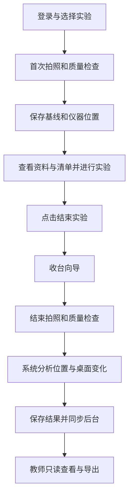
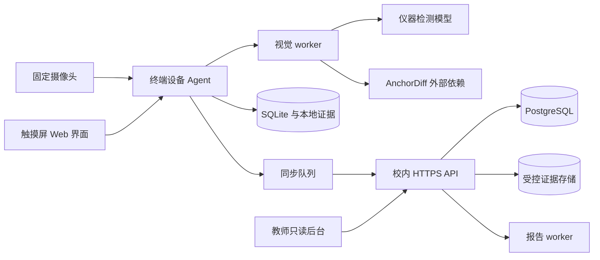

# 智能实验室终端设计开发文档

本文定义智能实验室终端的产品行为、硬件方案、算法集成、软件架构、数据与安全规则，以及从原型到试点的开发方法。开发人员可以据此拆分任务，教师和实验室管理人员可以据此检查流程与验收范围。

系统以每次实验的首次有效桌面照片为基线，在收台后自动比较仪器位置和桌面可见变化，输出扰乱度、每个目标框的解释和证据记录。触摸屏提供实验资料与收台流程，教师后台查看记录和导出报告。

## 1 文档控制

| 项目 | 内容 |
|---|---|
| 文档版本 | 0.1.0 |
| 日期 | 2026-10-12 |
| 项目阶段 | 设计基线，终端与后台业务程序待开发 |
| 适用场景 | 电子实验室固定工位，固定或大体固定的摄像头 |
| 算法依赖 | AnchorDiff v0.6.1，规则方法 sca-0.3 |
| 配套文档 | 目标检测训练与部署规范、接口与数据契约、开发实施与验收计划、设计决策记录 |
| 变更要求 | 需求、数据契约、模型、算法配置与验收用例同步修订 |

本文按需求、架构、算法、实施、验证和运维组织，供工程评审与实施使用；不构成已经取得某项标准认证的声明。文中的时延、精度、数据量和留存周期如无特别说明均为规划值或配置建议。

## 2 产品定义与边界

### 2.1 目标

终端减少实验前后记录和收台反馈的重复工作，并让每一项系统结论都能找到对应图像、目标框、位移或残余区域。系统不要求学生提前配置区域，也不要求管理员先把所有仪器分配到固定归位区。

首拍位置就是本次比较的期望位置。若首拍时已有杂物或仪器位置不符合实验室规范，这些问题可能不会作为新增变化出现。因此本系统输出的是相对基线的可见变化，不能单独证明桌面达到了统一卫生标准。

### 2.2 视觉对象

仪器检测类别按实际实验室需求建立，例如示波器、焊台、直流电源、万用表、信号发生器。类别数量可扩展，不把限定为 4–6 类作为实施前提。能否加入某类取决于镜头中是否可见、训练数据是否覆盖、定位框是否稳定以及独立测试是否通过。

电阻、电容、焊锡丝、线缆、纸张、个人物品等默认不逐项识别；其变化可能出现在残余区域中。解释应写“未被仪器变化解释的可见区域”，不能凭残余框认定其中一定是线缆、垃圾或私人物品。

检测类别不等于物理资产身份。两台同型号示波器交换位置，当前类别与几何匹配可能无法识别交换。需要资产追踪时，应另立需求并选择资产标签或专门身份识别，不把定位标记转用为仪器身份。

### 2.3 判定规则

系统自动输出对象变化与 `disorder_score`。教师后台只读查看及导出，不设置改分、改状态、人工覆盖或“复核通过”按钮。`needs_review` 在本系统界面表示“证据不足，系统暂不可判定”；教师可以查看这条记录，但不能通过填入分数解除状态。

扰乱度是规则生成的比较分，范围为 0–1，数值越高代表被计入规则的变化越多。它不等于风险概率、实验完成质量、仪器资产丢失、学生成绩或安全合格结论。焊台余温、电源断电和电气安全按实验规程处理，不能由桌面照片保证。

## 3 角色与权限

| 角色 | 允许操作 | 权限边界 |
|---|---|---|
| 学生或小组 | 登录、选授权实验、查看资料、提交清单、结束、收台、按提示重拍 | 仅当前被授权会话；不能提交或编辑算法分数 |
| 教师 | 查看授权课程记录、查看证据、筛选、创建与下载报告 | 只读业务结果；没有改写判定接口 |
| 管理员 | 管理课程、设备和授权；发布新的配置与资料版本 | 不能覆盖历史结果和会话配置；配置变更留审计记录 |
| 运维服务 | 设备诊断、同步恢复、按权限创建重新分析任务 | 新建分析 attempt，保留旧结果；不得伪造学生拍照或改分 |
| 设备视觉 worker | 为所属工位拍照、推理、保存证据与同步 | 设备身份绑定工位；浏览器前端不能冒用 worker 上传结果 |

人员可以具有多个明确授予的角色，但教师只读规则不能通过 UI 隐藏按钮代替服务端授权。管理员或运维角色另行授权，并与教师会话分开。

## 4 需求规格

### 4.1 功能需求

| 编号 | 需求 | 完成条件 |
|---|---|---|
| FR-01 | 登录、选实验与创建会话 | 课程授权正确；同一工位最多一个活动会话；请求可幂等重试 |
| FR-02 | 首拍与有效基线 | 保存桌面 ROI、图像哈希、锚点与质量证据；不合格图片不成为有效基线 |
| FR-03 | 仪器及位置记录 | 输出类别、xywh 框和置信度；不凭类别生成资产 ID |
| FR-04 | 资料与清单 | 支持版本化实验目标、步骤、PDF/图片、仪器清单和人工勾选事项；离线缓存可用 |
| FR-05 | 结束与收台向导 | 结束按钮进入收台状态；完成向导后才终拍；不能因按钮重复点击生成重复会话 |
| FR-06 | 位置变化与逐框解释 | 统一坐标后匹配；默认位置容差 0.1；展示稳定、移动、未检出、新出现及不确定说明 |
| FR-07 | 扰乱度与质量拒答 | 输出 0–1 数值和残余区域；门控失败输出 null 与原因 |
| FR-08 | 教师查看 | 支持课程、日期、实验、工位、分数范围和不可判定状态筛选；结果只读 |
| FR-09 | 报告导出 | 生成 CSV 与版式报告；包括算法/模型版本、逐框说明、时间和质量状态；权限受控 |
| FR-10 | 离线与恢复同步 | 已授权且缓存完整的实验可离线完成；恢复后按幂等事件同步，不丢记录或重复归档 |
| FR-11 | 可追溯与删除 | 保存模型与配置快照和证据关联；按批准留存策略删除，保留必要删除审计 |
| FR-12 | 设备与运维 | 监测相机、存储、温度、队列和服务状态；支持版本回滚与诊断 |

### 4.2 非功能需求

| 编号 | 建议验收目标 | 验证方法 |
|---|---|---|
| NFR-01 | 合格图像从确认终拍到本地结果，p95 ≤ 5 秒 | 目标硬件至少 200 次完整分析，报告 p50/p95 与最慢样本 |
| NFR-02 | 稳定运行 8 小时，无崩溃、持续积压或不可接受的热降频 | 触屏、相机、检测和同步同时运行，记录温度/频率/内存/队列 |
| NFR-03 | 离线完成已授权实验，重启后恢复一致状态 | 断网、进程退出、掉电恢复模拟；不声称 SQLite 可以避免所有存储损坏 |
| NFR-04 | 教师越权访问与结果写操作全部拒绝 | 课程/对象级授权、直接调用 API、导出与证据下载测试 |
| NFR-05 | 结果可复现到指定版本和输入 | 保存图像哈希、相机/ROI、模型/decoder/规则/后端版本和依赖锁定 |
| NFR-06 | 触屏可独立完成正常课堂流程 | 大触控目标、明确加载态、无遮挡提示；不依赖键盘命令 |

暂不开发连续录像、过程实时纠错、人脸识别、接线拓扑判定、电气参数采集和视觉自动评分计入成绩。材料清单可由人勾选，但不据此伪造视觉识别结果。

## 5 业务流程与异常处理

### 5.1 正常流程



学生先登录和选实验，系统检查相机、磁盘、当前会话及缓存资料。首拍前提示手和身体离开桌面视野，固定曝光后短时连拍，从质量合格帧中选择一帧，完成定位和检测后冻结有效基线。

实验中触摸屏显示资料与清单。学生点击“结束实验”后进入收台向导，依次确认停止操作、依实验规程处理供电与热源、收回个人物品、整理线缆、恢复仪器位置和退出拍摄区域。向导中的人工确认是操作记录，不是图像证明已经安全断电。

完成向导后终拍、挑帧、对齐、检测和分析。终端反馈提交完成、是否需要重拍与是否待同步；正常流程不向学生展示教师报告中的逐框分析和完整分数。教师查看系统保存的结果并导出，用于线下反馈。

### 5.2 状态与恢复

| 状态 | 进入条件 | 下一步与恢复规则 |
|---|---|---|
| AWAITING_BASELINE | 授权登录后创建会话，等待有效首拍 | 无效可重拍；没有有效基线不能进入正常分析 |
| IN_PROGRESS | 有效基线与首拍检测已冻结 | 查看资料与实验；重启恢复当前会话 |
| CLEANUP | 点击结束 | 进入向导；正常学生流程不提供返回实验入口 |
| AWAITING_FINAL | 向导完成或系统要求重拍 | 终拍；选中帧才进入分析 |
| ANALYZING | 输入、版本与任务 ID 已持久化 | worker 计算；崩溃按同任务重试，避免重复结果 |
| RECAPTURE_REQUIRED | 证据不可判定且仍有重拍预算 | 按具体原因重拍；不输出有效分数 |
| FINALIZED | 系统生成有效结果 | 本地终结；后台显示结果只读；同步可仍 pending_sync |
| INCOMPLETE | 无有效基线、重拍耗尽或受控中断 | 保存已有证据与原因；不能补造正常结果 |
| CANCELLED | 尚未进入实验即取消会话 | 留最小审计信息，不形成评分 |

业务状态、计算任务状态、算法可判定性和同步状态独立。`FINALIZED + pending_sync` 表示本地分析成功但尚未同步，不应显示“算法需复核”。建议终拍后最多 3 次额外重拍，次数属于版本化交互配置；超限保存不可判定记录并进入 INCOMPLETE，不强行生成分数。设备故障先恢复最后可靠状态，确实无法恢复时记录中断。

每次分析都是不可变 attempt。正常流程由系统选定首个通过全部门控的有效 attempt，学生不能比较分数后选择低分。重拍或运维重算新建记录并保留原因与旧引用，不能覆盖历史；提交后不能通过更换首拍基线消除已有变化。

## 6 交互与教师后台

### 6.1 终端页面

| 页面 | 核心内容 | 操作约束 |
|---|---|---|
| 设备准备 | 当前工位、相机与联网状态、登录入口 | 相机/磁盘异常明确提示，不能静默继续 |
| 实验选择 | 授权实验、资料版本、会话恢复入口 | 无授权缓存时断网不可新增未知学生会话 |
| 首拍确认 | 桌面预览、拍照倒计时、无遮挡提示 | 初次基线接受后冻结；不要求学生画归位区 |
| 实验资料 | 原理、步骤、清单、进度与结束按钮 | 结束按钮触发向导，不直接完成归档 |
| 收台向导 | 操作提醒与确认项 | 明确需要人执行的安全步骤 |
| 终拍与提交 | 拍摄、分析进度、可执行的重拍原因 | 不显示把 null 当作 0 的进度或结果 |
| 完成页面 | 完成时间、记录号、待同步或不可判定状态 | 超时自动退出登录；不暴露上一位学生资料 |

### 6.2 后台与报告

列表分别显示分数、是否不可判定及同步/处理状态；不保留 `level=clean/mild` 等旧分类。详情页展示首拍、终拍、对齐图、逐框叠加图、对象变化表、残余区域表、质量原因和版本。原图和对齐图不能用同一坐标框混画。

对象说明举例：“示波器框中心移动 8 像素，对象尺度为 100 像素，归一化位移 0.08，小于容差 0.10，位置大体不变。”未检出写“结束图中未检出原有类别实例”，避免写“仪器遗失”。残余说明写“该区域有 420 个未解释变化像素，占有效桌面区域 0.12%”，不能写未检测到的具体物品名称。

报告包含会话代号、课程与工位、起止时间、首末拍时间、有效证据图、系统分数或不可判定原因、对象状态与位移、残余区域、配置/模型/算法版本和分析 attempt。默认使用学员代号；显示姓名须有明确课程授权。可附独立线下反馈页，但不在系统中写入教师改判定结果。

## 7 总体架构与技术选型



### 7.1 建议技术栈

| 层 | 建议 | 选型依据 |
|---|---|---|
| 终端 UI | Vue 3、TypeScript、本地 Web kiosk | 适合触屏和后台共享组件；限制导航与会话残留 |
| 端侧服务 | Python、FastAPI、独立视觉 worker | 复用 AnchorDiff/OpenCV；避免推理堵塞 API 主线程 |
| 采集与几何 | Linux V4L2 或 OpenCV，ArUco/AprilTag | USB UVC 驱动普遍；定位模块与设备逻辑解耦 |
| 原型检测 | PyTorch/Ultralytics 本地权重 | 先验证数据与算法接口，模型许可证另行核对 |
| CPU 推理 | ONNX Runtime | 为开发 PC 和性能基准提供确定模型格式 |
| RK3588 推理 | RKNN Toolkit 转换与 Lite runtime | 加速网络前向，需开发专用输出解码与板级验证 |
| 本地持久化 | SQLite 事务与 outbox 队列 | 单工位结构简单；证据写入原子化并校验哈希 |
| 服务端 | FastAPI、PostgreSQL、私有文件或对象存储 | 课程授权、审计和导出；不默认要求公有云 |
| 报告 | CSV 与 HTML/PDF worker | 可离线反馈；导出走相同权限校验 |

这些是实施建议，当前仓库不宣称已经存在服务或一键部署。RK3588 的系统镜像、Python 与 RKNN 版本须建立兼容矩阵，不能默认开发 PC 的依赖可以直接安装到开发板。

### 7.2 端侧与服务端职责

端侧受管视觉 worker 持有模型与冻结配置，完成分析并写入本地证据。触屏浏览器只能请求操作，不能指定分数、算法版本或上传任意正式结果。服务端按设备身份、工位归属、对象授权、schema、版本与内容哈希验证上传并归档。

设备认证证明来源及传输完整性，不能证明被攻陷设备的分析一定诚实。对高要求场景可增加签名软件、设备加固和独立服务端复算；复算生成带后端标识的新 attempt，不假设 RKNN 与 ONNX 结果逐数值相同。

## 8 硬件与摄像头安装

### 8.1 选型配置

| 部件 | 原型建议 | 采购前确认 |
|---|---|---|
| 计算板 | RK3588 Linux 开发板，8 GB 内存候选 | BSP、NPU runtime、长期供货、恢复镜像、接口和散热 |
| 存储 | 64 GB 或更大 eMMC/SSD 候选 | 按实际图片容量与离线留存估算；避免依赖低质量卡持续写入 |
| 摄像头 | USB UVC、1080p/更高分辨率候选，可控制曝光与焦距 | Linux 驱动、畸变、锐度、视野、固定对焦、抗频闪 |
| 触摸屏 | 10–13 英寸、至少 1280×800 候选 | HDMI/DSI 兼容、触控驱动、可读性、支架与防误触 |
| 镜头与支架 | 刚性固定、高位俯视或后上方斜视 | 无侵入操作区、无热源接触、视角不被学生遮住 |
| 光照 | 漫射稳定补光或受控环境灯 | 示波器屏幕和金属表面反光、阴影与交流灯频闪 |
| 网络 | 有线以太网优先，Wi-Fi 备选 | 校内认证、防火墙、设备证书与断网恢复 |
| 电源与散热 | 合规独立电源、散热器与受控风扇候选 | 板卡、屏幕、相机峰值功率总和与余量；8 小时压力测试 |

RK3588 适合做候选端侧平台，但 NPU 的标称算力不能推出完整应用时延。对齐、差分、连通域、数据库与报告并不会全部运行在 NPU；CPU 端残余分析也需要计入预算。模型训练在开发 PC/GPU 工作站进行，开发板用于推理与验证。

### 8.2 安装位置比较

| 位置 | 优点 | 主要限制 | 建议 |
|---|---|---|---|
| 高位近顶视 | 桌面遮挡少、位置比较直观 | 高支架安装和走线要求高 | 有条件时优先 |
| 后上方斜视 | 容易固定在桌后结构，维护方便 | 前后仪器互相遮挡，立体物体视差 | 安装困难时首选候选，必须实拍验证 |
| 屏幕后低位前视 | 安装方便 | 仪器遮挡桌面，个人身体容易进入视野 | 不作为桌面变化主相机 |
| 可移动手持 | 无固定支架 | 大视角变化和高物体视差使前后比较失效 | 不适合本项目基线 |

单应性只保证近似共面桌面锚点的对应。示波器、焊台上部离桌面较高，相机移动后即使桌面锚点重投影误差很小，仪器仍可能出现假位移。因此要先稳定支架和视角，强运动时拒答，不把平面透视校正当成三维重建。

### 8.3 标定与安装验收

测量桌面可用范围、最高仪器和支架空间，使用厂家 FOV 数据估算镜头。近顶视时覆盖宽度约为 `2 × 高度 × tan(水平视场角/2)`；斜视不能直接套用该式决定覆盖范围，应现场检查最远端与遮挡。

先去镜头畸变，再用分散在桌面边缘、至少四个非共线且匹配可靠的锚点建立桌面坐标。标记 ID 对应锚点位置，尺寸由镜头中可辨识的像素数决定，不固定指定一种打印尺寸。相机、镜头、分辨率、支架或 ROI 改变时重新标定。

安装验收拍摄常用仪器布置、有人操作但尚未提交、收台无遮挡、最亮与最暗照明条件。记录桌面覆盖、定位稳定性、高仪器框抖动、反光和长时间温漂。若遮挡不可接受，调整支架或增加辅助相机需单独评审；首版不直接引入多视角融合增加复杂度。

容量示例：每会话保存 4 张平均 0.6 MB 的图，40 会话/日、30 天，约 2.9 GB 图像数据；还须加短时候选帧、失败 attempt、报告、数据库、模型和安全余量。该计算是规划示例，实际容量按试采集文件分布重新测量。

## 9 算法方案与 AnchorDiff 集成

### 9.1 完整链路

拍摄短序列 → 检查候选帧 → 选择最终帧 → 去畸变与桌面 ROI → 检查锚点和相机变化 → 对齐到冻结基线 → 在同一坐标图像上检测仪器 → 同类别匹配 → 解释仪器变化区域 → 计算残余差分 → 质量门控 → 生成数值与逐框证据。

基线的清晰度与锚点同样必须通过检查。终拍不能与任意旧实验或空桌模板比较。挑帧后再检测所选帧，不能复用另一帧的检测框。

### 9.2 必需技术与可选技术

| 技术 | 首版用途 | 取舍 |
|---|---|---|
| ArUco 或 AprilTag | 获取桌面几何锚点 | 二选一先验证，标记不识别仪器 |
| 镜头标定与单应性 | 去畸变、桌面坐标对齐 | 固定镜头前提，超出稳定范围拒答 |
| 轻量目标检测模型 | 仪器类别、bbox 与 confidence | 微调现成模型，无须从零实现通用检测器 |
| 匈牙利算法 | 同类首末观察的全局分配 | 仍需拒配与模糊匹配策略，不能保证资产身份 |
| median/MAD 像素差分 | 获取对光照变化较稳健的变化掩码 | 大范围变化会影响阈值，需要坏案例测试 |
| 连通域与规则评分 | 残余框、面积与可解释分数 | CPU 成本需实测；不能只报 NPU 前向速度 |
| SSIM | 可选局部结构变化参考 | 不是当前 AnchorDiff 主评分，验证收益后再加入 |
| 形态学处理 | 可选残余噪点清理 | 开运算可能抹掉细线；核大小需按 ROI 像素尺度标定 |
| 实例分割或轮廓掩码 | 改进解释区域精度 | bbox 基线后再评估，不作为首版必需条件 |

### 9.3 位置容差

首末框为 `b0=(x0,y0,w0,h0)` 与 `b1=(x1,y1,w1,h1)`，框中心分别为 `c0` 与 `c1`。

```text
scale = max(sqrt(w0*h0), sqrt(w1*h1), 1)
displacement = EuclideanDistance(c0, c1) / scale
stable  当 displacement <= 0.1
moved   当 displacement > 0.1
```

例如两次框均为 100×100 像素，中心移动 8 像素，归一化位移为 0.08；中心移动 12 像素则为 0.12。`0.1` 是相对目标尺度的位移，不是 0.1 像素，也不是桌面宽度的 10%。

框尺寸随视角、遮挡或检测抖动变化会影响归一化尺度。首版保留算法定义，并评估同一仪器重复拍照的框抖动；如未来改用固定基线尺度、底面点或实际毫米，必须新建配置/方法版本并重新做边界验收。

### 9.4 对象变化解释

同 label 目标通过几何代价矩阵与匈牙利算法匹配，输出 `stable`、`moved`、`missing`、`new`。`missing` 表示终拍没有匹配检测，不直接证明物品离开工位；`new` 表示仅终拍出现类别实例，不证明是新购资产。未检测到、遮挡和同类替换需应用层增加不确定原因。

当前 AnchorDiff 对 moved/missing/new 的 mask 或 bbox 生成解释区域；稳定对象不整块扣除。bbox 会包含目标周围桌面，可能把其中的杂物变化也当作已解释；分割 mask 较精确但需额外模型或轮廓质量验证。不能声称使用 bbox 就保证不会漏报桌面变化。

### 9.5 残余区域与实际评分公式

对同坐标图像，计算通道平均绝对像素差 `diff`。当前阈值为：

```text
threshold = max(12, median(diff) + 4 * max(MAD(diff), 1))
changed_mask = diff > threshold
residual_mask = changed_mask AND NOT explained_mask
```

残余连通域使用四邻域，记录 bbox、变化像素面积、面积比例和中心点。面积比例不是 bbox 面积比例。残余可以来自杂物，也可以来自照明、显示屏画面、阴影或未被充分解释的仪器边缘。

当前 `analyze_pair` 路径的实际评分为：

```text
r = residual_area_ratio
n = connected_components
L = largest_component_ratio
k = moved_count + missing_count + new_count
score = min(1,
    0.55 * min(r/0.20, 1)
  + 0.15 * min(n/12, 1)
  + 0.15 * min(L/0.12, 1)
  + 0.10 * min(k/3, 1))
```

代码同时记录空间熵特征，`classify_disorder` 的其他调用形式还包含熵项；但当前 `analyze_pair` 传入字典时熵项为零，因此该路径理论最高分为 0.95。对外字段仍规定为 0–1，不将分数偷偷重新归一化，也不声称现有接口已经按空间熵加权。调整公式须新增规则版本、保留旧结果并重新验证。

当前分数同时计入仪器变化和未解释区域，不是纯杂物面积。若产品未来需要“仪器位置分”与“桌面残余分”分别显示，可新增两个来源清晰的分量，不能把现有总分改名后改变含义。

### 9.6 质量门控与不可判定

现有基础门控包括梯度能量清晰度、亮度、极端像素比例、对齐置信度和低检测置信度。当前核心门槛包含 blur_score < 5、brightness < 0.05 或 > 0.95、clipped_ratio > 0.25、alignment_confidence < 0.80、任一传入检测 confidence < 0.60。它们是 v0.6.1 代码默认值，不是所有相机的最佳参数。

应用层还必须检查有效基线、锚点数量与几何分布、相机位移、图像 ROI 有效覆盖、手部/人体遮挡、检测突然为空、同类分配模糊、框尺寸异常和视差风险。部分遮挡门控可能需要附加模型，不能把“提示学生移开手”当成已经可靠检测了手。

任何关键门控失败，应用层最终 `disorder_score=null`，`needs_review=true`，保存可执行原因和可能的预览框；不把原始低可信分数展示为有效结果。基础结果可以保留在受控 attempt 中用于诊断，但不得与正式最终结论混淆。

### 9.7 已有能力与集成待办

| 当前能力或限制 | 系统实施要求 |
|---|---|
| 已有 Detection、对象匹配、残余和规则分数接口 | 固定依赖 v0.6.1 与模型/配置版本，创建应用适配层 |
| 核心对齐图像时不同时变换 final bbox/mask | 应用先对齐图像再检测，并传入同坐标图像和框；避免二次变换 |
| 外部对齐后核心可能按恒等对齐计算 confidence | 外部门控保存真实几何质量并独立拒答，不能被恒等 confidence=1 掩盖 |
| CLI 叠加图使用原始 selected 图像 | 实验室在对齐图上渲染，或把全部证据反变换到原图；不直接沿用错位 overlay |
| 序列接口不能给每一帧绑定独立检测集 | 先挑帧，再检测选中帧，最后比较 |
| ONNX/RKNN 默认解码是六列最终检测 | 原始 YOLO head 需专用 decoder、置信度计算、NMS 与 letterbox 逆变换 |
| RKNN runtime API 与输入宽高约定待板级核对 | 核对实际 RKNNLite 类名、RGB/BGR、张量布局、非方形输入与初始化 |
| 现有按类别/几何强制分配部分目标 | 增加代价拒配、数量变化与模糊配对门控；保留原始结果与应用不确定原因 |
| 稳定小位移仍可能产生边缘残余 | 单独评估容差内移动；候选边缘带/配准策略需保证不遮住真实新增物 |
| 默认连通域为 CPU Python 路径 | 在真实尺寸压力测试；如优化为 OpenCV，验证四邻域等价性与结果版本 |
| 当前质量门控覆盖有限 | 新增前后均检查、缺锚点、遮挡和强运动门控，按拒答覆盖率评价 |

这些是实施门禁，必须在课堂试点前处理。集成适配层放本仓库；若修复属于通用能力，可以在 AnchorDiff 独立开发与发布后再升级版本，不将实验室业务塞进算法仓库。

## 10 目标检测训练设计

### 10.1 数据与标注

先收集真实固定镜头中的仪器，不用网上孤立产品图替代课堂域数据。采样覆盖工位、仪器型号、时段、光照、屏幕内容、角度、相似型号、局部遮挡、空桌、反光和非仪器负样本。短视频可以本地取帧用于采集，但训练数据不能把同一连拍分散到训练与测试集。

每个仪器按统一可见框规则标注类别与 xyxy/YOLO 格式，并记录是否遮挡、截断、反光和来源分组。原始图仅用于受控标注，训练与推理按约定桌面 ROI/坐标处理；如果训练用已对齐图，部署也应使用对应预处理。需要 mask 时单独增加分割标注规范。

划分以工位、采集日期/课次、连续拍摄组和物理仪器为组合分组，先锁定独立测试集，再做训练与验证。最终划分应匹配部署范围；宣称跨工位泛化时，必须有未参与训练的工位测试，不只按随机图片 8:1:1 划分。

### 10.2 训练路线

微调现成轻量 YOLO 模型，保留初始 CPU/ONNX 基准；先排查数据与标签问题，再调整模型容量或分辨率。无需先从零开发通用目标检测算法。模型选择应依据仪器召回、定位抖动、同类误检、延迟和许可证，不能仅凭 mAP 排名。

训练记录包含数据清单/哈希、类别版本、预训练权重来源与许可、随机种子、超参数、软件版本和验证结果。INT8 量化校准图只能来自训练/专门校准分组，不能使用独立测试集。详细命令、decoder 约定与 RKNN 步骤见训练规范。

### 10.3 部署验收

同一测试图依次比较 PyTorch、ONNX 与 RKNN 的预处理后输入、原始输出、解码框、NMS 后框和最终对象状态。排查通道、归一化、输入布局、输出布局、padding/scale 和类别映射，而不是只检查模型是否能加载。

记录每类 precision/recall、mAP、定位误差、重复拍照框中心抖动、missing 误报、匹配状态 F1 和 INT8 相对基准退化。检测 confidence 是模型得分，未经校准不直接标为“系统结论准确概率”。

## 11 接口与数据保存

应用统一使用 RGB uint8 图像、固定桌面比较坐标和像素 xywh 框。固定有效矩形 ROI 的比较图命名为 `baseline_registered_pixel`，以该裁剪图左上角为原点；原始相机到比较图的复合变换包含裁剪偏移。模型输入的 resize/letterbox 坐标不得流入业务接口。mask 若存在，应为对应比较图大小的二维布尔数组。坐标名称、宽高、ROI、变换矩阵和有效区域都随 capture 保存。

AnchorDiff v0.6.1 的差分面积分母是整幅输入图，没有任意有效区域 mask 的分母参数。首版在基线接受时冻结双方预期可完整覆盖的有效矩形，分析图全幅都是有效桌面区域；若终拍变换后不能完整覆盖该固定 ROI，应重拍或拒答，不能每次缩小 ROI 改变评分分母。未来支持不规则有效区域必须修改算法、记录新版本并重新验证。

核心实体为课程与实验模板、授权主体、工位/设备、会话、capture、模型/配置版本、分析 attempt、对象变化、残余区域、同步事件、导出任务和审计事件。身份映射与视觉记录分别存放。schema 不设置教师改判定表。

```json
{
  "schema_version": "1.0.0",
  "session_id": "session_demo_001",
  "attempt_id": "attempt_demo_001",
  "source": "edge_worker",
  "execution_state": "SUCCEEDED",
  "inputs": {"coordinate_system": "baseline_registered_pixel"},
  "decision": {
    "status": "determined",
    "disorder_score": 0.18,
    "needs_review": false,
    "reasons": [],
    "object_uncertainties": []
  },
  "anchordiff_result": {
    "disorder_score": 0.18,
    "needs_review": false,
    "objects": [
    {
      "label": "oscilloscope",
      "status": "stable",
      "action": "within_position_tolerance",
      "baseline_bbox": [100, 80, 100, 100],
      "final_bbox": [108, 80, 100, 100],
      "displacement": 0.08,
      "position_tolerance": 0.1,
      "explanation": "final bbox remains within the allowed position tolerance"
    }
    ],
    "residual_regions": []
  },
  "provenance": {
    "anchordiff_version": "0.6.1",
    "rule_version": "sca-0.3",
    "detector_version": "instrument-detector-demo",
    "decoder_version": "decoder-demo",
    "camera_config_version": "camera-demo"
  }
}
```

这是字段结构示例，分数与对象并非实际运行结果，省略了完整哈希、质量与残余证据，不用于公式验算。正式 schema、完整示例、错误码和 API 见接口契约。

数据库使用外键/唯一约束保证一个工位一个活动会话、幂等事件唯一、capture 与 attempt 归属一致。图像先写临时文件，完成哈希和原子提交后再关联数据库；定期检查孤立文件与失联引用。服务器保存接收哈希并校验重复请求，一样 ID 不同内容返回冲突，不悄悄覆盖。

## 12 离线部署与运维

设备首次注册后获取工位绑定与课程授权。正常运行通过内网 HTTPS 同步版本化资料。断网时只开放已缓存且未过期的离线授权，不能把“可离线”理解为任意账号都能登录。资料、模型、规则和会话写入的版本保持一致。

端侧用 SQLite 事务将业务记录与 outbox 事件一并保存，后台同步采用指数退避与抖动，校验时钟异常并同时记录本地顺序。图像上传完成、哈希一致后才能标记事件已同步。服务器不可用不妨碍本地完成，但磁盘将满时阻止新会话并提示运维，不能在没有证据保存能力时继续生成记录。

Linux 服务建议交由 systemd 管理，UI 采用 kiosk 模式，推理服务单独进程。配置进程健康检查、磁盘容量、队列长度、相机失联和温度告警；日志不记录姓名、密钥、完整图片或带凭据 URL。看门狗和自动重启须有重试上限，避免故障循环。

更新先停止接收新会话，等待活动会话结束或记录受控中断，再安装经过验证的签名/哈希发布包；保留上个应用、模型与配置组合，可回滚。数据库迁移先备份并验证恢复，结果记录的版本不能因新软件上线而改写。

## 13 隐私与网络安全设计

### 13.1 数据最小化

摄像头物理视野限制在桌面，默认不录音、不保存连续视频、不做人脸识别。短时挑帧在内存中完成，只按策略持久化选中 ROI 与必要失败证据。若人物进入图像，优先拒绝提交并要求移开；不能声称未经开发和验证就已能可靠自动遮脸。

本地与后台仅保存用途所需图像和结构化结果。学员代号是伪名化，不是彻底匿名；身份映射只由授权身份服务提供。显示器、纸张或照片中可见姓名、账号、网络配置等也可能泄露信息，公开演示时必须逐图检查并裁剪/遮盖。

图像 30 天、结构化记录 180 天可作为可调示例，正式周期须由学校按用途批准。到期清理包括本地缓存、后台文件、导出副本和备份到期处理；法律或管理要求保留的记录须有独立依据。删除任务留最小审计，不继续保存已删除内容。

### 13.2 访问与软件供应链

终端业务 API 默认仅监听本地或受控内网接口；服务端通过校内反向代理 HTTPS，证据存储不公开列目录。证据 URL 须短期有效、绑定权限并防止跨课程下载；URL 中不含身份或长期密钥。管理员与教师会话、设备身份分别管理，设备丢失可吊销凭据。

服务端实施课程级与对象级 RBAC；teacher 直接请求结果更新接口也必须拒绝。设备 worker 使用受限文件权限和独立服务身份。浏览器采用 CSP、适当 CSRF 防护、会话超时、输入校验和禁止任意文件路径；PDF/资料上传校验类型、大小和处理资源限制。

模型权重来自审核后的本地制品，不由运行时自动联网下载未知文件。固定依赖与模型哈希，检查 PyTorch 权重反序列化风险、模型/预训练权重/数据集许可、SBOM 与漏洞更新；不要将 AnchorDiff 的 Apache-2.0 许可自动扩展为检测模型许可证。

导出 CSV 对以 `= + - @` 或控制字符开头的文本做公式注入防护，同时保留原值在受控数据库；HTML/PDF 中转义用户字段。导出任务创建和下载都验证授权，失效链接不能继续使用。

### 13.3 仓库与发布去敏

`.gitignore` 排除数据、图像目录、身份映射、模型权重、密钥、数据库、日志和导出文件，但忽略规则不能代替内容扫描。提交前检查文件清单、凭据模式、个人信息、真实内网地址、图片 EXIF 与文档作者元数据。

本仓库保持独立本地维护。公开发布时只使用合成或经授权并去敏的例图，不上传课堂原图、姓名学号、设备凭据或校园部署细节。敏感文件已经入历史时不能只删工作区文件，应吊销泄露凭据并按要求清理历史。

## 14 测试与验收设计

### 14.1 算法验收

| 指标 | 建议目标与解释 |
|---|---|
| 仪器检测 | 受控有效图像每类 recall ≥ 0.90、precision ≥ 0.90；报告样本数与 95% CI，不只报整体平均 |
| 位置状态 | 独立前后样本 accepted 部分的状态 macro-F1 ≥ 0.90；0.1 边界附近单独报告 |
| 未检出误报 | 无真实缺失且证据合格的对象中，系统 missing 比例建议 ≤ 3%；遮挡单独分析 |
| 稳定误判移动 | 真实稳定且证据合格对象中 moved 比例建议 ≤ 5%；0.1 边界附近单独报告 |
| 质量拒答 | 分别报告坏证据拒答率、好证据误拒率、coverage 与被接受样本错误率；不能只追求低拒答率 |
| 容差内残余 | 位置变化 ≤ 0.1 的重复拍照样本单独测试，记录 score/残余面积抖动与漏报风险 |
| 残余区域 | 与独立标注变化掩码比较 IoU、区域召回及背景误检；考虑 mask 标注的不确定边界 |
| 扰乱度 | 验证无变化低分、变化增加的排序与稳定性；对严重光照/遮挡拒答，不建立虚假的统一整洁真值 |
| INT8 退化 | 和冻结浮点基准比较每类召回、框偏移、状态翻转与拒答；门槛在部署前锁定 |

正常输入覆盖率建议 ≥ 0.90，同时满足错误率门槛；预先定义的严重质量问题拒答召回建议 ≥ 0.95。所有统一门槛以开发实施与验收计划的冻结版本为准，训练转换的专用回归指标另外报告。

既有 AnchorDiff 合成样例或单元测试只证明实现回归，不能替代真实仪器、真实光照与 RK3588 运行评价。独立测试集在模型和规则选定前冻结；试点中为诊断而看的失败样本不能继续当作完全未接触测试集。

对于二分类误报和召回报告 Wilson 或适当二项置信区间；macro-F1、分数排序与时延按会话/工位分组 bootstrap，避免把连拍帧当成独立样本。低错误率需要足够样本：独立样本中零错误时，95% 错误率上界约为 3/n，此近似只用于规划而非替代正式统计。

### 14.2 系统与安全验收

覆盖重复点击结束、同 ID 不同内容上传、断网恢复、token 过期、相机拔出、磁盘将满、worker 崩溃、进程重启、掉电后的未完成记录、版本回滚与报告超时。每个用例验证记录完整性、可恢复状态和用户提示，而不只观察服务是否还能启动。

教师跨课程获取图片、修改结果、猜测导出 ID 和访问过期证据 URL必须被拒绝。发布检查包括默认网络暴露、弱口令/默认密钥、CSV 注入、文件路径穿越、日志泄密与真实课堂数据入仓库。完整需求到测试的映射见验收计划。

## 15 开发组织与交付流程

采用先减少成像不确定性、再打通闭环、然后迭代检测与性能的顺序。首版不以限定仪器种类或画固定归位区开场，而以明确接口、稳定拍照、可靠数据和可追溯记录为前置条件。

| 阶段 | 工作 | 交付与出口条件 |
|---|---|---|
| P0 设计与接口冻结 | 确认本文、角色、坐标、分数定义与数据留存 | 需求/接口/验收基线一致，待实测事项有负责人 |
| P1 相机与可采集数据 | 借用相机和 PC，试安装、标定、质量采样 | 桌面可见、固定视角可靠；高仪器视差和遮挡已量化 |
| P2 业务闭环原型 | 登录、首拍、资料、结束、向导、终拍、本地记录 | 用合成/受控样例跑通流程；结果来源标清，不冒充真实模型 |
| P3 检测训练与算法集成 | 标注微调、decoder、统一坐标、AnchorDiff、应用门控 | 冻结测试集通过；逐框与残余解释可查；门控拒答有效 |
| P4 RK3588 部署 | RKNN 转换、INT8 验证、CPU 残余性能与散热 | 正确性与时延达标，报告全链路 p95/温度/资源 |
| P5 后台与安全 | 只读查看、报告、幂等同步、权限、去敏与恢复 | 越权拒绝、断网/崩溃测试、留存清理和备份恢复通过 |
| P6 真实课堂试点 | 受控试点、收集反馈、分析误判与覆盖率 | 形成验收报告、缺陷清单、运维手册与发布包 |

训练数据准备可在 P1 后与 P2 并行；后台骨架与端侧同步可并行，但必须先冻结契约。按实际团队和采购周期估算工期，不用未经确认的单人周数保证交付。

业务开发建议目录为 `apps/terminal-ui`、`apps/teacher-ui`、`services/edge`、`services/backend`、`packages/contracts`、`training`、`deploy`、`tests`。这些为后续规划目录，当前仓库主要交付文档，不放置看似可运行但缺少实现的空启动脚本。

每个变更先关联需求/缺陷，修改适当层并进行相关验证，再评审与本地提交。跨模型、规则或配置的发布要标记兼容组合；敏感制品走受控存储。当前设计文档与实现版本分别维护，不把文档版本 0.1.0 当作软件已发布版本。

## 16 风险与处理责任

| 风险 | 影响 | 处理与负责领域 |
|---|---|---|
| 相机移动或立体视差 | 仪器假移动与残余增大 | 结构安装、强运动门控、现场测量，硬件/视觉共同负责 |
| 灯光、屏幕画面或阴影 | 残余误报 | 稳定补光、质量证据与坏案例验证，视觉负责 |
| 同类仪器替换或相互遮挡 | 匹配错误与 missing 误报 | 模糊分配/拒配，身份追踪另立需求，视觉负责 |
| 检测框整块解释 | 框内新物被忽略 | bbox 基准失败集与可选 mask，视觉负责 |
| 容差内移动产生差分 | 稳定却有高残余分 | 边缘抖动评估与受控改进，视觉负责 |
| 原始 YOLO/RKNN 输出约定错误 | 类别或框全部错误 | 中间张量/坐标一致性验证，训练与端侧负责 |
| 数据泄露与过拟合 | 指标虚高、真实效果差 | 分组划分与独立测试冻结，数据负责人负责 |
| NPU 快但 CPU 链路慢 | 交互等待和过热 | 全链路 profiling、等价优化，端侧负责 |
| 离线数据或同步损坏 | 记录缺失/重复 | 事务、outbox、校验与恢复演练，后端/端侧负责 |
| 权限或隐私配置错误 | 身份与图像泄露 | 对象级授权、最小数据、去敏与审计，后端/管理员负责 |
| 学生改变首拍布置 | 基线偏离实验室期望 | 首拍规范与记录查看；绝对规范检查须另立模板需求 |
| 误把 score 当安全或成绩 | 错误决策 | UI/报告采用准确含义，产品与课程负责人负责 |

## 17 技术学习与官方资料

先理解图像坐标、bbox 与 ROI，再学习标定/单应性、数据标注与检测训练、匈牙利匹配和差分，最后学习部署、权限与恢复。每学一个模块都用本项目的可控样例验证输入、输出与失败条件，不必先完成全部计算机视觉理论。

| 资料入口 | 用途 |
|---|---|
| [AnchorDiff 仓库](https://github.com/Lemeroy/anchordiff) | 固定版本阅读 core、geometry、detectors 与证据输出 |
| [OpenCV ArUco 教程](https://docs.opencv.org/4.x/d5/dae/tutorial_aruco_detection.html) | 定位标记、角点与 ID |
| [OpenCV 相机标定教程](https://docs.opencv.org/4.x/dc/dbb/tutorial_py_calibration.html) | 内参、畸变和重投影误差 |
| [OpenCV 单应性教程](https://docs.opencv.org/4.x/d9/dab/tutorial_homography.html) | 平面变换的条件与用途 |
| [Ultralytics 文档](https://docs.ultralytics.com/) | 数据格式、训练、导出；同时核对模型与软件许可 |
| [ONNX Runtime 文档](https://onnxruntime.ai/docs/) | CPU 模型执行、输入输出与优化 |
| [RKNN Toolkit2](https://github.com/airockchip/rknn-toolkit2) | 对应版本模型转换、校准与 Lite runtime |
| [SciPy 线性分配文档](https://docs.scipy.org/doc/scipy/reference/generated/scipy.optimize.linear_sum_assignment.html) | 理解匈牙利类分配问题；本项目不强制新增 SciPy 依赖 |
| [OWASP ASVS](https://owasp.org/www-project-application-security-verification-standard/) | 应用授权、会话、文件与输入处理验收参考 |

以上是学习与实现入口，不是本项目精度和性能的证据。采购、模型许可和依赖 API 在选定版本时逐项确认。
